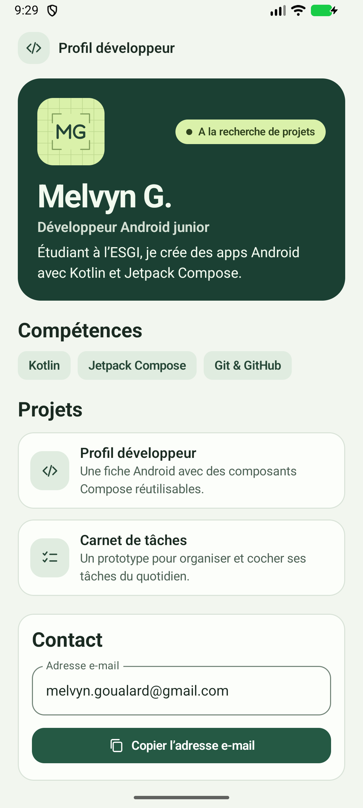
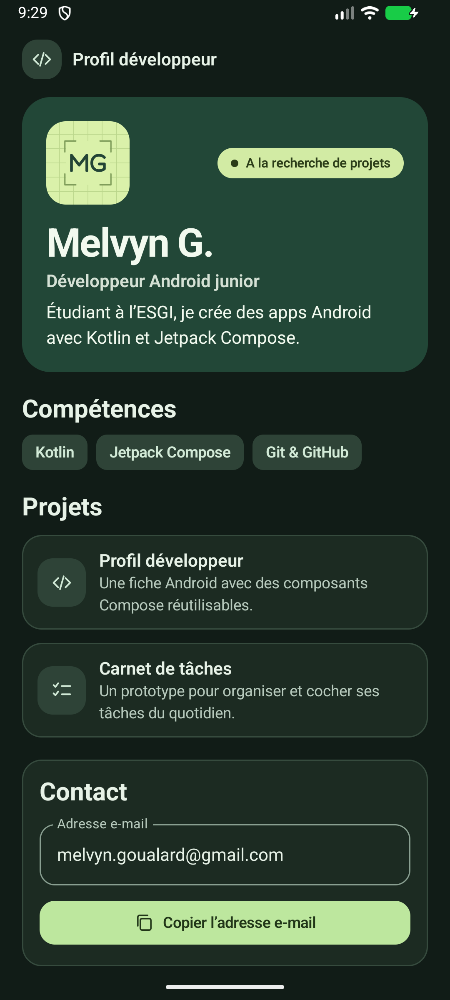

# Profil développeur

Application Android en Jetpack Compose qui présente Melvyn G., étudiant à l’ESGI et développeur Android junior. La fiche affiche son avatar, sa disponibilité, ses compétences, deux projets et son adresse e-mail. Le bouton de contact copie cette adresse dans le presse-papiers.

## Captures d’écran

Les deux captures ont été prises sur un émulateur Android.

| Thème clair | Thème sombre |
| --- | --- |
|  |  |

## Composants Compose

- `Text` affiche les titres, la présentation et les descriptions.
- `Image` affiche l’avatar aux initiales de Melvyn, tandis que les `Icon` accompagnent les projets et l’action de copie.
- `Card` regroupe la présentation, chaque projet et le contact. `Surface` donne une forme et une couleur aux compétences, au badge et aux icônes.
- `OutlinedTextField` présente l’adresse e-mail en lecture seule. `Button` appelle le callback de copie.

## Layouts et liste des projets

- `Scaffold` fournit les marges des barres système. Une `Box` centre la fiche sur les écrans larges.
- `Column` empile les éléments des cartes. `Row` aligne les icônes, l’avatar et les textes qui les accompagnent. `Spacer` règle les espacements.
- `FlowRow` permet aux compétences de passer à la ligne quand la largeur disponible diminue.
- Une seule `LazyColumn` fait défiler toute la fiche. Sa fonction `items(profile.projects)` associe chaque objet `Project` à un `ProjectCard` réutilisable. Les données sont définies directement en Kotlin dans [DeveloperProfile.kt](app/src/main/java/fr/esgi/profilcompose/DeveloperProfile.kt).

## Thème Material 3

Le thème suit le réglage clair ou sombre d’Android. Deux palettes vertes personnalisent `MaterialTheme.colorScheme`. Le vert clair accentue la disponibilité et les tons plus foncés structurent les cartes et l’arrière-plan. La typographie distingue le nom, les titres de section et les descriptions. Les formes arrondies de `MaterialTheme.shapes` sont communes aux deux modes.

Les previews **Clair** et **Sombre** affichent le même profil dans [DeveloperProfileScreen.kt](app/src/main/java/fr/esgi/profilcompose/DeveloperProfileScreen.kt).

## Quelles notions du chapitre Compose UI avez-vous réutilisées ?

J’ai combiné les layouts pour structurer la fiche, créé des cartes et des badges réutilisables, affiché les projets avec une liste paresseuse et relié le bouton de contact à un callback. Le thème Material 3 applique les mêmes styles et formes aux deux modes, que les previews permettent de comparer.

## Lancer le projet

Ouvrir le projet dans Android Studio avec le SDK Android 37, puis lancer le module `app` sur un émulateur ou un appareil Android compatible. Depuis PowerShell, la compilation et le lint se lancent avec le wrapper Gradle.

```powershell
.\gradlew.bat :app:assembleDebug :app:lintDebug
```
